<h1 align="center">🔫 Laser Royale</h1>

<p align="center">
  <b>A two-player wireless laser tag game.</b><br>
  Arduino Uno blasters · IR shots · ZigBee (XBee) · Java live scoreboard
</p>

<p align="center">
  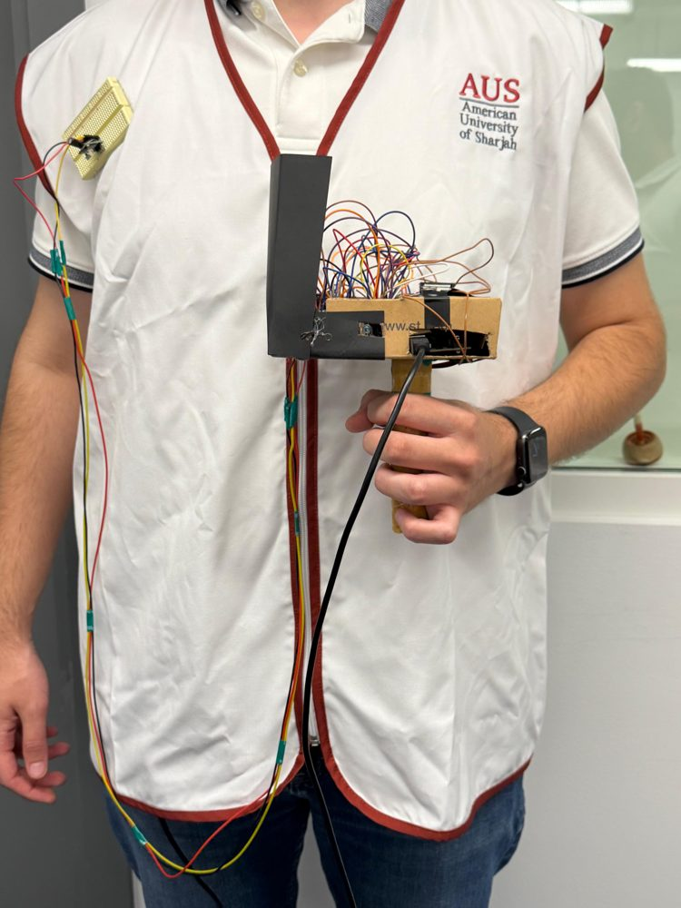
  &nbsp;
  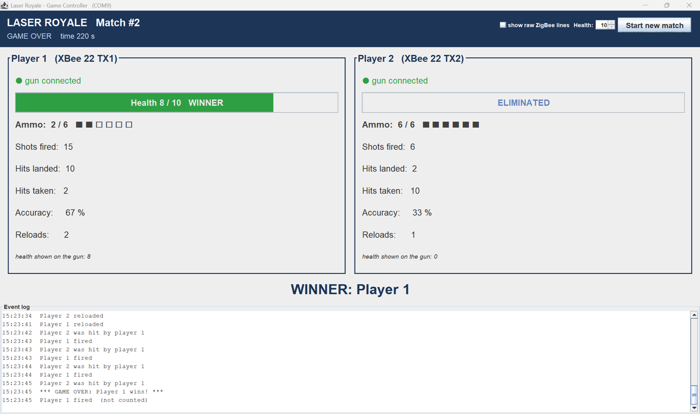
</p>

<p align="center">
  COE 421L – Computer Systems Engineering Lab · American University of Sharjah · Fall 2026
</p>

---

## 🎯 What is it?

Two players, two blasters, one winner. Each player carries an **IR blaster** and wears an **IR receiver on their chest**. Shoot your opponent's chest to drain their health, manage your **6-shot magazine**, and **reload** by physically pulling the magazine out and pushing it back. Every shot, hit and reload is sent over **ZigBee** to a **Java controller** on the PC, which runs the match and shows a live scoreboard.

**Last player standing wins.**

## ✨ Features

- 🔦 **Aimed IR shots:** a narrow-beam TSAL6100 IR LED sends coded shots carrying the shooter's ID, so you can't hit yourself.
- ❤️ **Health and damage:** 10 health, 1 damage per hit, elimination at 0.
- 🔄 **Physical reload:** a reflective IR sensor detects the magazine. Pull it out for 2 s, push it back, and you have 6 shots again.
- 📳 **Instant feedback:** green/red LEDs, buzzer sounds and vibration for firing, hits, empty clicks, reloads, death and victory.
- 📡 **Wireless:** both guns report to the PC over ZigBee (XBee 802.15.4), using a loss-tolerant protocol.
- 🖥️ **Live scoreboard:** health bars, ammo, accuracy, reloads, event log and the winner, in a Java Swing dashboard.

## 🧩 How it works

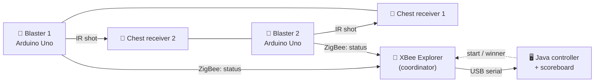

Each gun sends its **running totals** every second and after every change:

```
<id, shots, hitsTaken, health, ammo, magazineIn, reloads, check>     e.g. <1,12,3,7,4,1,2,30>
```

Because they are totals, a lost ZigBee message fixes itself with the next one, and the check number filters out damaged messages. The PC sends back `<S,10>` to start a match and `<W,2>` to announce the winner.

## 🛠️ The hardware

| | |
|---|---|
| 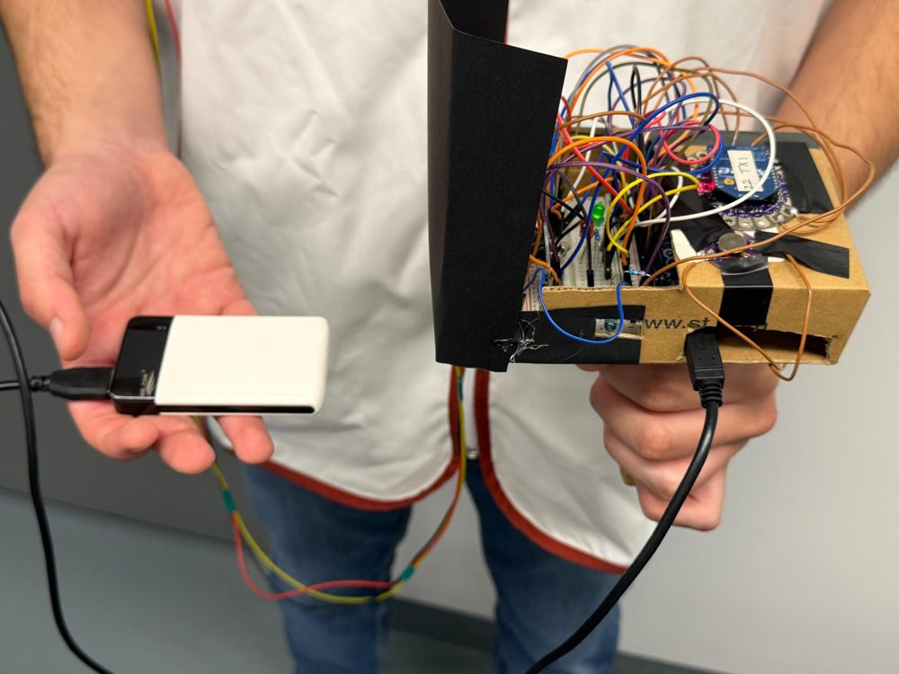 | 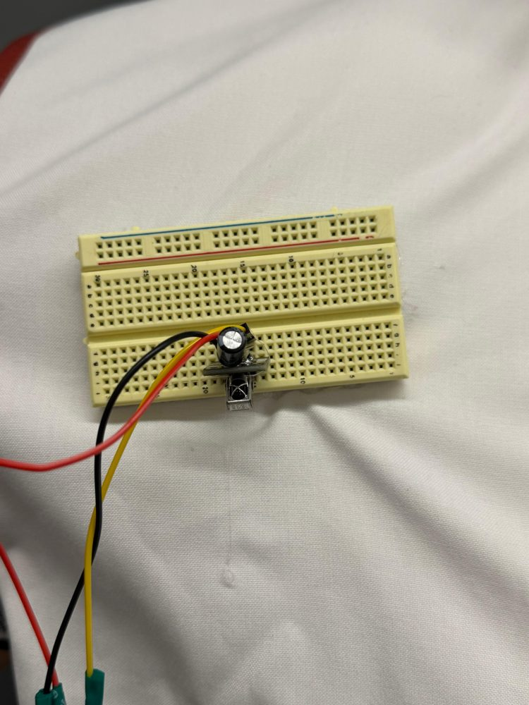 |
| **The blaster:** cardboard body, black paper barrel, powered by a USB power bank. | **The chest receiver:** KY-022 IR receiver and a 47 µF filter capacitor on a mini breadboard, cabled to the gun. |
| 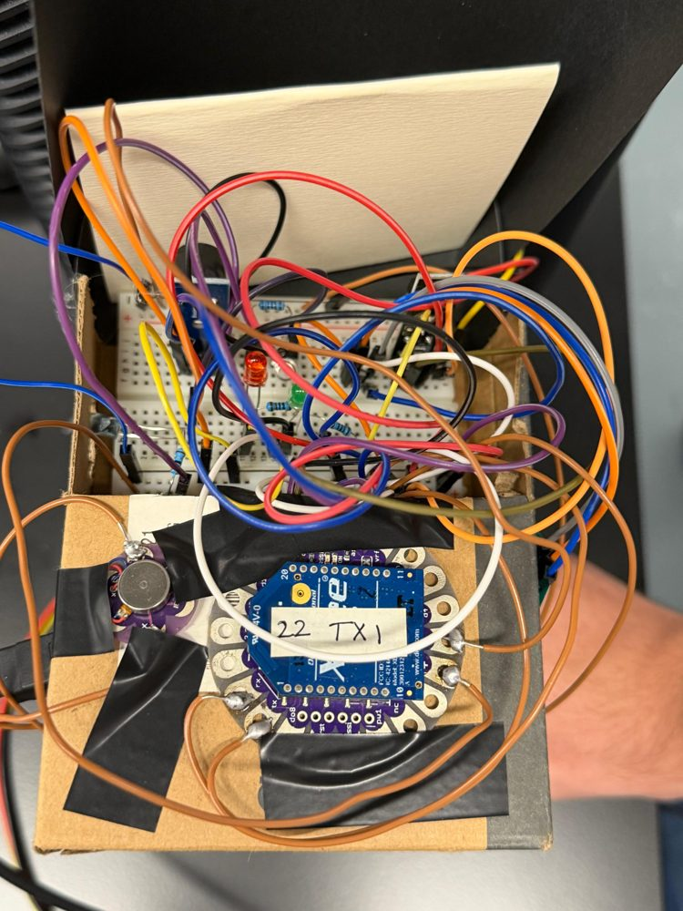 | 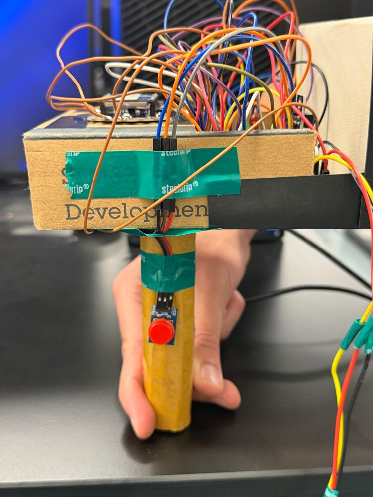 |
| **Inside:** Arduino Uno, breadboard and the XBee end device. | **Grip:** the trigger button and the magazine slot with the reload sensor. |

**Per player:**

| Part | Arduino pin | Role |
|---|---|---|
| KY-022 IR receiver (chest) | D2 | Detects the opponent's shots |
| Push button module | D4 | Trigger |
| LilyPad Vibe Board | D5 | Vibrates when hit |
| Green / red LED | D6 / D7 | Health and status |
| Active buzzer module | D8 | Game sounds |
| TSAL6100 IR LED + BC107B transistor | D9 | Fires the IR shot (38 kHz from Timer1) |
| LilyPad XBee + XBee 802.15.4 | D10 / D11 | ZigBee link to the PC |
| TCRT5000 reflective sensor | D12 | Detects the magazine (reload) |

**PC side:** XBee Explorer USB with the coordinator XBee.

<p align="center">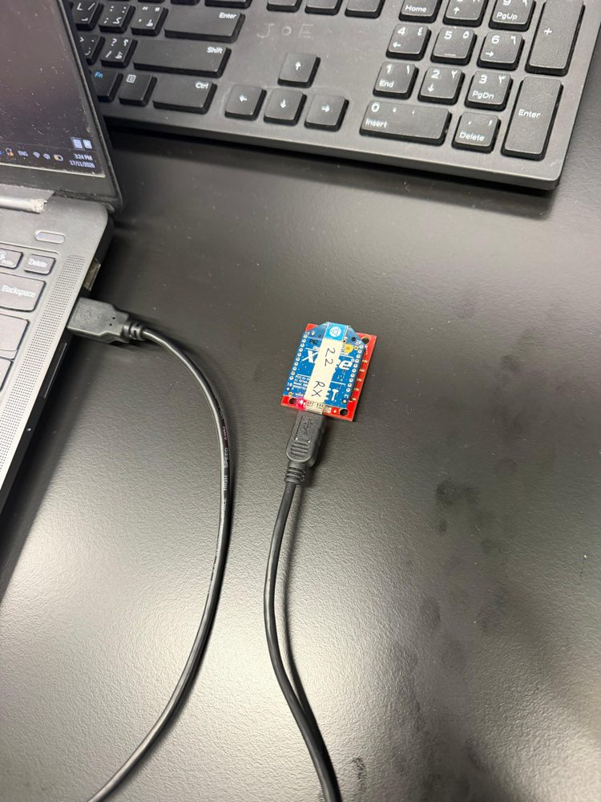</p>

## 🎮 Game feedback

| Event | LEDs | Sound | Vibration |
|---|---|---|---|
| Match starts | 🟢 Green on | beep beep beep beeeep | – |
| Fire | 🟢 Green on | short beep | – |
| Fire with an empty magazine | 🔴 Quick red blink | tiny click | – |
| Magazine pulled out | 🟢 Green blinks fast | – | – |
| Reloaded (out ≥ 2 s) | 🟢 Green on | beep-beep-beeep | – |
| Hit | 🔴 Red flash | double beep | short buzz |
| Low health (≤ 3) | 🟢 Green blinks slowly | – | – |
| Eliminated | 🔴 Red stays on | long buzz | long buzz |
| Win / lose | 🟢 Fast blink / 🔴 Red on | victory tune / two long buzzes | – |

## 🖥️ The scoreboard

| Waiting for the guns | Mid-match |
|---|---|
| 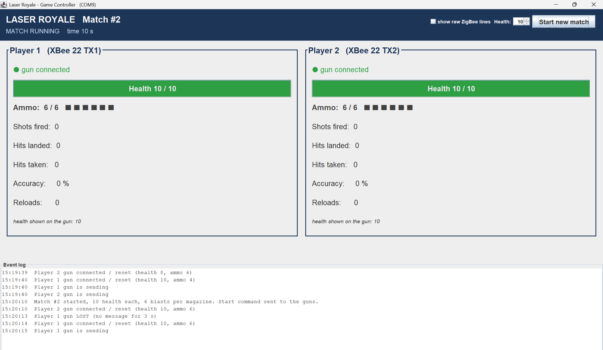 | 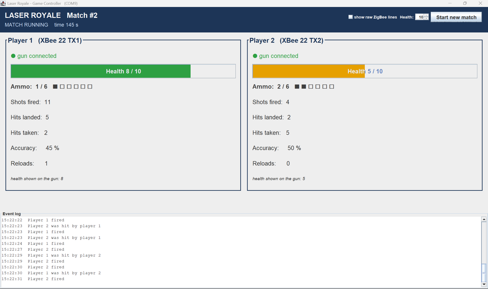 |
| **Empty magazine** | **Reloading** |
| 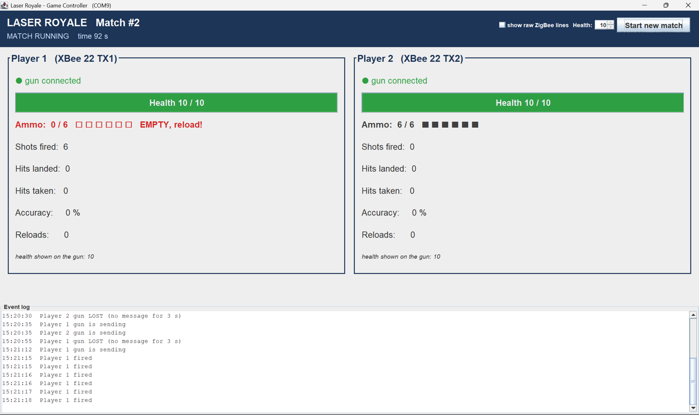 | 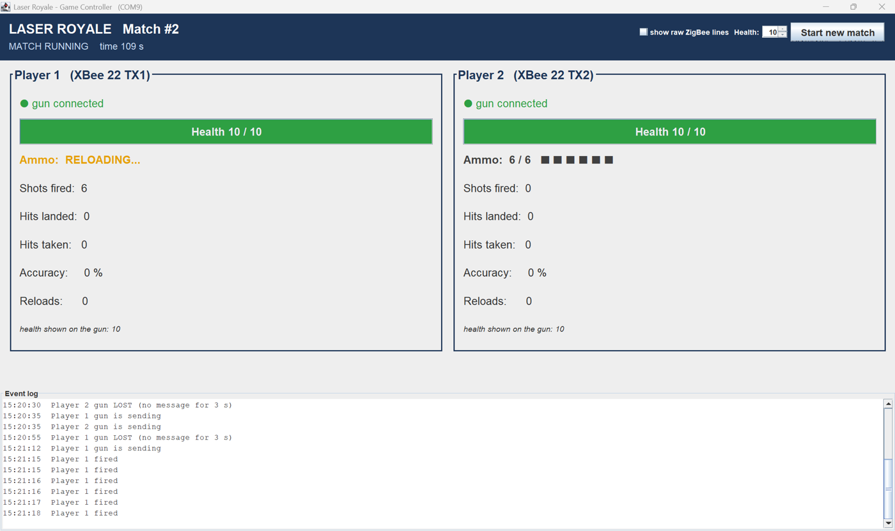 |

## 🧱 Software design

**Arduino (`arduino/LaserRoyale_Gun`):** object-oriented C++:
- `PlayerNode` runs the gun.
- `Sensor` subclasses: `PushButton`, `PhotoelectricSensor`, `IRReceiver`.
- `FeedbackDevice` implementations: `StatusLed`, `Buzzer`, `VibrationMotor`.
- `IREmitter` and `XBeeRadio`.

Nothing uses `delay()` in the feedback, so the gun never stops listening for hits.

**Java (`java/src`):**

| Feature | Where |
|---|---|
| **Observer** pattern | `Subject` / `Observer` interfaces, `GameController` notifies `Dashboard` and `ConsoleLogger` |
| **State** pattern | `WaitingState` → `RunningState` → `GameOverState` |
| **Factory** pattern | `EventFactory` turns messages into `FireEvent`, `HitEvent`, `ReloadEvent`, `StatusEvent` |
| **Singleton** | `GameController` |
| **Multi-threading** | serial reader thread → event queue → game logic thread, a watchdog thread, and the Swing thread |

## 🚀 Getting started

### 1. Arduino (both blasters)
1. Install the **IRremote** library (by ArminJo, 4.x) from the Arduino Library Manager.
2. Open `arduino/LaserRoyale_Gun/LaserRoyale_Gun.ino`.
3. Set `PLAYER_ID = 1`, then upload to blaster 1 (**Board: Arduino Uno**).
4. Set `PLAYER_ID = 2`, then upload to blaster 2.

### 2. Java controller (PC)
Full steps are in **[java/README.md](java/README.md)**. In short:
1. Create an Eclipse Java project and copy in `java/src`.
2. Add `java/lib/jssc-2.9.6.jar` with **Build Path → Configure Build Path → Libraries → Classpath → Add External JARs**.
3. Plug in the XBee Explorer and run **`LaserRoyaleApp.java`**.
4. Pick the Explorer's COM port, switch on both blasters and press **Start new match**.

<p align="center">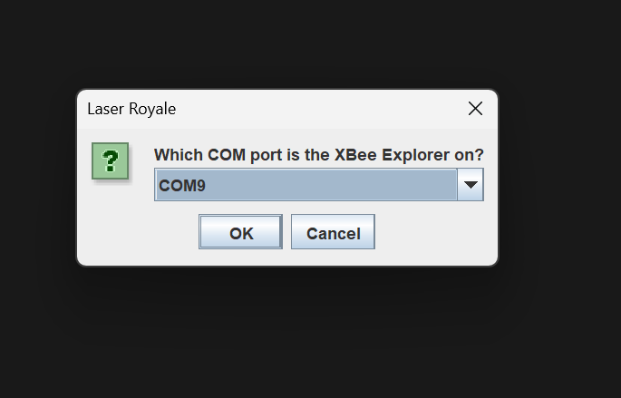</p>

## 📁 Repository structure

```
Laser-Royale/
├── arduino/
│   └── LaserRoyale_Gun/LaserRoyale_Gun.ino   # code for both blasters
├── java/
│   ├── src/                                  # Java game controller
│   ├── lib/jssc-2.9.6.jar                    # serial port library
│   └── README.md                             # Java setup guide
└── docs/images/                              # pictures used in this README
```

## 👥 Team

Mustafa Al-Abdullah · Jehad Barham · Rizwanul Asim · Mohammed Tonse

Instructor: Mr. Ali Reza Sajun

---

<p align="center"><i>Aim. Fire. Reload. Survive.</i></p>
